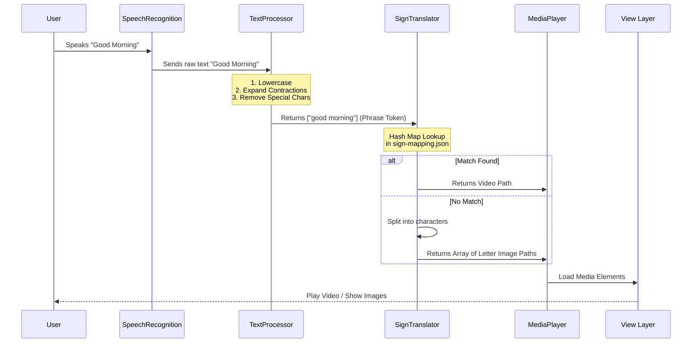

# 📘 Project Methodology & Implementation Details

This document provides a comprehensive technical deep-dive into the SignSpeak implementation. It outlines the architectural decisions, data flows, and custom algorithms that power the application without the use of external AI or ML frameworks.

---

## 🏗️ System Architecture

The application follows a modular **Model-View-Controller (MVC)** adaptation, designed for purely client-side execution with a lightweight Python development server.

### Architecture Diagram

```mermaid
graph TD
    subgraph "Client Layer (Browser)"
        UI[User Interface]
        subgraph "Core Logic Modules"
            CTRL[app.js (Controller)]
            SR[speechRecognition.js]
            TP[textProcessor.js]
            ST[signTranslator.js]
            MP[mediaPlayer.js]
            MG[mediaGenerator.js]
        end
    end

    subgraph "Data Layer"
        JSON[sign-mapping.json]
        MEDIA[Media Files (MP4/JPG)]
    end

    UI -->|Events| CTRL
    CTRL -->|Control| SR
    CTRL -->|Input| TP
    CTRL -->|Tokens| ST
    CTRL -->|Instructions| MP
    
    SR -->|Text| UI
    TP -->|Clean Tokens| ST
    ST -->|File Paths| MP
    
    MP -->|Request| MEDIA
    ST -->|Lookup| JSON
    
    MP -.->|Fallback| MG
    MG -->|Generated Image| MP
```

### Module Responsibilities

1.  **`app.js` (Controller)**: Central orchestrator. Initializes the app, manages state (current language, mode), and routes data between modules.
2.  **`speechRecognition.js`**: Wraps the browser's `webkitSpeechRecognition` API. Handles microphone access and real-time speech-to-text conversion.
3.  **`textProcessor.js`**: The "Brain" of the text handling. Performs normalization, contraction expansion, and tokenization.
4.  **`signTranslator.js`**: Maps processed text tokens to media resources using a dictionary lookup strategy.
5.  **`mediaPlayer.js`**: Handles the logic for playing a sequence of videos or displaying a grid of images.
6.  **`mediaGenerator.js`**: Dynamically creates placeholder images using the HTML5 Canvas API when static assets are missing.

---

## 🔄 Data Flow Process

The following flowchart illustrates the step-by-step transformation of user input into visual sign language output.

### Execution Flowchart



---

## 🧠 Algorithms & Logic

Since we strictly avoid "Black Box" AI models, every step of the processing pipeline is deterministic and rule-based.

### 1. Tokenization Strategy (Greedy Approach)
The `textProcessor.js` module uses a **greedy longest-match-first** strategy. This is crucial for distinguishing between individual words and phrases.

*   **Logic**:
    1.  The system loads a list of known phrases (e.g., "what is your name", "good morning").
    2.  It sorts these phrases by length (longest to shortest).
    3.  When scanning the input text, it attempts to match the longest signs *first*.
    4.  **Example**: For input "Good morning everyone", it matches "Good morning" as a single token, rather than processing "Good" and "Morning" separately.

### 2. Bilingual Text Normalization
The system supports both English and Hindi (transliterated or Devanagari) via custom Regex patterns.

*   **Hindi Detection**: Checks for Unicode range `\u0900-\u097F`.
*   **Mapping**: Uses a hardcoded dictionary map to translate common Hindi phrases to their English semantic equivalents *before* sign lookup (e.g., "Mera naam" -> "My name").

### 3. Fallback Generation System
To ensure the app never "breaks" on unknown words, `mediaGenerator.js` implements a dynamic generation algorithm:

*   **Input**: A text label (e.g., "ComplexWord").
*   **Process**:
    1.  Create an HTML5 Canvas element in memory.
    2.  Fill background with a generated gradient based on a hash of the text (ensuring consistent colors for the same word).
    3.  Render text centered on the canvas.
    4.  Convert canvas to Data URL (`data:image/png;base64...`).
*   **Output**: An instant, valid image source for the UI.

---

## 🛠️ Implementation Details

### Directory Structure Rationale
*   `data/`: Separating `sign-mapping.json` allows non-developers to update sign data without touching code.
*   `media/`: Organized by language (`asl`/`isl`) and category (`phrases`/`alphabet`) to mimic the logical structure of the data.

### Performance Optimization
*   **Event Delegation**: Used in the gallery view to minimize event listeners on individual grid items.
*   **Lazy Loading**: Video elements are created and loaded only when required for playback, conserving bandwidth.
*   **No Polling**: The application is entirely event-driven (User Click -> Action), reducing CPU cycle usage.
