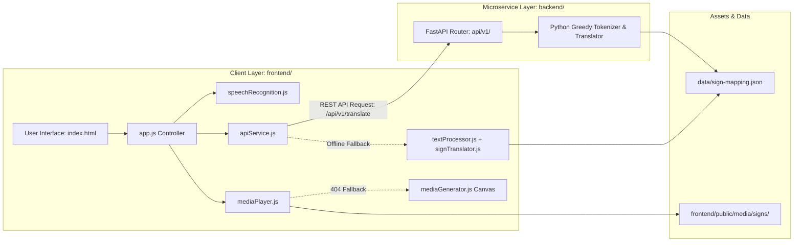

# 🤟 SignSpeak — Speech/Text to Sign Language System

[](https://fastapi.tiangolo.com)
[](https://www.python.org/)
[](https://developer.mozilla.org/en-US/docs/Web/JavaScript)
[](#-automated-testing)
[](LICENSE)

An accessible, real-time web application and microservice that converts spoken speech or typed text into American Sign Language (ASL) and Indian Sign Language (ISL) visual demonstrations (MP4 videos and image sequences).

Operates with **zero external machine learning bloat, zero heavy LLM latency, and zero user data transmission**, guaranteeing instant, deterministic, and privacy-preserving accessibility.

---

## 📑 Table of Contents
- [Core Features](#-core-features)
- [System Architecture](#-system-architecture)
- [Target Project Structure](#-target-project-structure)
- [Quick Start & Setup](#-quick-start--setup)
  - [Option A: FastAPI Backend Server (Recommended)](#option-a-fastapi-backend-server-recommended)
  - [Option B: Standalone Offline Frontend](#option-b-standalone-offline-frontend-zero-backend)
- [REST API Reference](#-rest-api-reference)
- [Automated Testing](#-automated-testing)
- [Sign Language Media Coverage](#-sign-language-media-coverage)
- [Documentation Index](#-documentation-index)

---

## ✨ Core Features

- 🎤 **Voice & Speech Recognition**: Integrates native browser Web Speech API (`SpeechRecognition`) for instant, private voice-to-text without cloud API fees.
- ⌨️ **Bilingual Text Input**: Supports standard English alongside Romanized Hindi conversational transliteration (e.g., *"namaste"*, *"aapka naam kya hai"*).
- 🇺🇸 **ASL & 🇮🇳 ISL Support**: Seamless toggle between American Sign Language and Indian Sign Language vocabularies.
- 🎬 **Dual Presentation Modes**:
  - **Video Mode**: Continuous, automated sequential playlist playback of high-definition demonstration clips with adjustable speed controls (`0.5x` to `2.0x`).
  - **Gallery Mode**: Responsive, accessible card grid displaying tokens in sentence order for step-by-step study.
- 📝 **Fingerspelling Cascade**: Unmapped words automatically decompose into letter-by-letter alphabet signs (A–Z).
- 🎨 **HTML5 Canvas Dynamic Fallback**: Missing media assets automatically render synthesized canvas badges on the fly.
- 🔒 **Absolute Privacy & Zero Latency**: Deterministic rule-based processing executing in under 50ms with zero cloud tracking.
- 🔌 **100% Offline Failover**: Frontend seamlessly fails over to autonomous client-side translation if the backend is offline.

---

## 🏗️ System Architecture

SignSpeak uses a decoupled, event-driven architecture combining a modular ES6+ frontend with a lightweight Python FastAPI microservice:



---

## 📁 Target Project Structure

```
SignSpeak/
├── frontend/
│   ├── index.html                       # Semantic HTML5 user interface
│   ├── assets/
│   │   ├── css/
│   │   │   └── styles.css               # Modern glassmorphic styling
│   │   ├── js/
│   │   │   ├── app.js                   # Application controller
│   │   │   ├── components/              # UI components (mediaPlayer, speechRecognition, mediaGenerator)
│   │   │   ├── services/                # apiService (with offline failover), signTranslator
│   │   │   └── utils/                   # config, textProcessor
│   │   └── images/                      # Static branding assets
│   └── public/
│       ├── data/                        # Client-accessible sign-mapping.json
│       └── media/                       # Video & image demonstrations
│           ├── extracted/               # 13 Master demonstration clips
│           └── signs/asl/
│               ├── alphabet/            # 26 Letters (A-Z)
│               └── phrases/             # 13 Phrase MP4 clips
├── backend/
│   ├── app/
│   │   ├── main.py                      # FastAPI application & static mounts
│   │   ├── api/v1/                      # Health, translate, and signs endpoints
│   │   ├── services/                    # text_processor, translator_service
│   │   ├── models/                      # schemas.py (Pydantic models)
│   │   └── utils/                       # config.py
│   ├── tests/                           # Unit and API integration tests
│   └── requirements.txt                 # FastAPI & Uvicorn dependencies
├── data/
│   └── sign-mapping.json                # Master sign mapping registry (single source of truth)
├── scripts/
│   ├── convert_videos_to_images.py      # Video frame extraction utility
│   ├── extract_asl.py                   # Kaggle ASL Alphabet unpacker
│   ├── organize_dataset.py              # Dataset normalization pipeline
│   ├── organize_videos.py               # Video clip path synchronizer
│   ├── server.py                        # Standalone Python dev host (zero dependencies)
│   └── setup_kaggle_dataset.py          # Kaggle dataset setup utility
├── docs/
│   ├── PRD.md                           # Product Requirements Document
│   ├── TRD.md                           # Technical Requirements Document
│   ├── METHODOLOGY.md                   # Core Algorithmic & Data Flow Deep Dive
│   └── README.md                        # Formal Documentation Index
├── tests/
│   ├── __init__.py
│   └── test_e2e.py                      # End-to-End System Integrity Tests
├── pytest.ini                           # Pytest configuration
├── brain.md                             # Master System Cognitive Blueprint
├── .gitignore                           # Git ignore rules
├── .env.example                         # Environment configuration template
└── README.md                            # Project README
```

---

## 🚀 Quick Start & Setup

### Option A: FastAPI Backend Server (Recommended)

1. **Install Dependencies:**
   ```bash
   python -m pip install -r backend/requirements.txt
   ```

2. **Launch the FastAPI Server:**
   ```bash
   python -m uvicorn backend.app.main:app --host 0.0.0.0 --port 8000 --reload
   ```
   *(Or run directly: `python backend/app/main.py`)*

3. **Open in Browser:**
   - 🌐 **Web App UI**: [http://localhost:8000](http://localhost:8000)
   - 📖 **Interactive Swagger API Docs**: [http://localhost:8000/docs](http://localhost:8000/docs)
   - 🩺 **Health Check**: [http://localhost:8000/health](http://localhost:8000/health)

---

### Option B: Standalone Offline Frontend (Zero Backend)

If running without FastAPI or completely offline, launch using Python's standard library:
```bash
python scripts/server.py
```
- Automatically serves `frontend/` at [http://localhost:8000](http://localhost:8000).
- Runs autonomously in client-side mode with greedy phrase tokenization, fingerspelling fallback, and canvas synthesis.

---

## 🔌 REST API Reference

The FastAPI microservice exposes the following endpoints:

| Method | Endpoint | Description | Query / Body Params | Response |
| :--- | :--- | :--- | :--- | :--- |
| `GET` | `/health` | Root diagnostic health check | None | `{"status": "healthy", "version": "2.0.0", ...}` |
| `GET` | `/api/v1/health` | API v1 status and sign statistics | None | Health diagnostic object |
| `POST` | `/api/v1/translate` | Deterministic text-to-sign translation | `{"text": "...", "language": "asl\|isl"}` | Structured token and sign objects |
| `GET` | `/api/v1/signs/mappings` | Query dictionary mappings for dialect | `language=asl\|isl` | Mapping dictionary |
| `GET` | `/api/v1/signs/phrases` | Query multi-word video phrase roster | `language=asl\|isl` | Registered phrase objects |
| `GET` | `/api/v1/signs/alphabet` | Query 26 alphabet letter image mappings | `language=asl\|isl` | 26 alphabet letter mapping dictionary |

---

## 🧪 Automated Testing

SignSpeak includes 24 automated unit, integration, and end-to-end tests covering API routes, text processing, sign mapping resolution, and file asset integrity:

```bash
# Execute entire test suite
python -m pytest -v
```

---

## 🎬 Sign Language Media Coverage

### Alphabet Signs (A–Z)
- 26 verified square high-contrast JPEG alphabet signs under `frontend/public/media/signs/asl/alphabet/`.

### Video Phrases (13 Master Clips)
- `Good morning.mp4` / `Good Evening.mp4`
- `How are you.mp4`
- `What is your name.mp4`
- `What are you doing.mp4`
- `Have a good day.mp4`
- `Monday.mp4` through `Sunday.mp4` (all 7 days of the week)

---

## 📚 Documentation Index

For in-depth specifications and architectural details:
- **[Product Requirements Document (PRD)](./docs/PRD.md)**: Product vision, user personas, functional & non-functional requirements.
- **[Technical Requirements Document (TRD)](./docs/TRD.md)**: Deep dive into technical architecture, Web APIs, data schemas, and security.
- **[Methodology & Implementation (METHODOLOGY.md)](./docs/METHODOLOGY.md)**: Custom tokenization algorithms, contraction rules, and data flow walkthrough.
- **[Master System Blueprint (brain.md)](./brain.md)**: Cognitive mental model, module interaction contracts, and operational playbooks.

---

## 📄 License
This project is licensed under the MIT License — see the [LICENSE](LICENSE) file for details.
