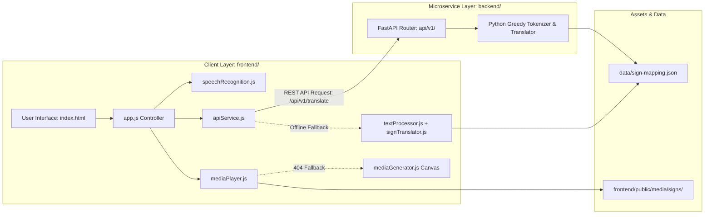

# 🤟 SignSpeak — Extensible ASL Recognition & Model Training Platform

[](https://fastapi.tiangolo.com)
[](https://pytorch.org/)
[](https://mediapipe.dev/)
[](https://www.python.org/)
[](#-automated-testing)
[](LICENSE)

**SignSpeak** is a webcam-based continuous American Sign Language (ASL) recognition and sentence-level English translation platform equipped with a reusable ML training pipeline capable of training, evaluating, and managing models across multiple compatible datasets (How2Sign, WLASL, MS-ASL, and local custom datasets).

---

## ✨ Core Platform Capabilities

- 📹 **Live Webcam ASL Recognition**: Real-time continuous sign recognition with landmark tracking (MediaPipe 144-dim hand & pose features), displaying partial and accumulated sentence transcripts directly from your webcam.
- 🔤 **Sentence-Level English Translation**: Translates continuous signing into fluent, grammatical English sentences (Task C), adjusting for ASL wh-question inversion and synthesizing omitted copulas/articles.
- 🔄 **Extensible Dataset Adapters**: Standardized adapter contracts for **How2Sign** (continuous ASL & translation), **WLASL** (word-level isolated), **MS-ASL**, and **Custom** local directories with signer-leakage detection.
- ⚙️ **Configurable Training Pipeline**: Pydantic-validated configuration schema with PyTorch trainers for:
  - **Task A**: Isolated Sign Classification (BiGRU-Attention)
  - **Task B**: Continuous Gloss Recognition (BiGRU with PyTorch CTCLoss)
  - **Task C**: Sentence-Level Sign-to-English Translation Pipeline
- 🏛️ **Local Model Registry**: Manages registered model versions with SHA-256 checksum verification, task compatibility enforcement, and one-click deployment to webcam inference.
- 🖥️ **Interactive Training Dashboard**: Browser dashboard for dataset validation, sample counts, train/val/test splits, real-time training progress, terminal log streaming, and model comparison.
- 💬 **Speech/Text to Sign (Deterministic Playback)**: Preserves the original high-fidelity deterministic speech/text-to-sign visualizer with ASL/ISL dictionaries and speed controls.

---

## 🏗️ System Architecture

SignSpeak uses a decoupled, event-driven architecture combining a modular ES6+ frontend with a lightweight Python FastAPI microservice:



---

## 📁 Target Project Structure

```
SignSpeak/
├── frontend/
│   ├── index.html                       # Semantic UI: Webcam, Dashboard, Playback
│   └── assets/
│       ├── css/styles.css               # Glassmorphic responsive styling
│       └── js/
│           ├── app.js                   # Main application coordinator
│           ├── components/
│           │   ├── webcamRecognition.js # Live webcam & real-time landmark inference
│           │   ├── trainingDashboard.js # Dataset validation & training manager
│           │   ├── mediaPlayer.js       # Video playlist & card presenter
│           │   └── speechRecognition.js # Web Speech audio capture
│           └── services/apiService.js   # Backend gateway & failover
├── backend/
│   ├── app/
│   │   ├── main.py                      # FastAPI app & static file mounts
│   │   ├── api/v1/
│   │   │   ├── recognition.py           # Real-time frame landmarks & transcripts
│   │   │   ├── datasets.py              # Dataset discovery, validation & manifests
│   │   │   ├── training.py              # Job runner & status monitoring
│   │   │   ├── models.py                # Model registry listing & selection
│   │   │   ├── evaluation.py            # Held-out benchmark evaluation
│   │   │   ├── health.py                # System diagnostics
│   │   │   ├── signs.py                 # Lexicon endpoints
│   │   │   └── translate.py             # Deterministic NLP translation
│   │   └── services/
│   │       ├── recognition_service.py   # Bounded sliding buffer & inference engine
│   │       ├── training_service.py      # Background worker with concurrency lock
│   │       └── translator_service.py    # Rule-based sign resolver
├── ml/
│   ├── datasets/
│   │   ├── base.py                      # Abstract DatasetAdapter & Manifest contracts
│   │   ├── custom.py                    # Custom local dataset adapter
│   │   ├── how2sign.py                  # How2Sign continuous ASL adapter
│   │   ├── wlasl.py                     # WLASL word-level adapter
│   │   └── ms_asl.py                    # MS-ASL isolated sign adapter
│   ├── preprocessing/
│   │   ├── landmarks.py                 # MediaPipe 144-dim hand & pose extractor
│   │   ├── sequence.py                  # Normalization & temporal resampling
│   │   └── vocabulary.py                # Vocabulary mapping & CTC special tokens
│   ├── models/
│   │   ├── isolated_classifier.py       # Task A: Spatial-Temporal BiGRU-Attention
│   │   ├── continuous_seq2seq.py        # Task B: Temporal BiGRU + CTC Recognizer
│   │   └── translation_pipeline.py      # Task C: Sign-to-English Translation Pipeline
│   ├── training/
│   │   ├── config.py                    # Pydantic v2 TrainingConfig
│   │   └── trainer.py                   # IsolatedSignTrainer & ContinuousGlossTrainer
│   ├── evaluation/
│   │   ├── metrics.py                   # Accuracy, WER, BLEU-4, chrF, Latency
│   │   └── evaluator.py                 # Checkpoint test-split evaluator
│   └── registry/
│       └── registry.py                  # LocalModelRegistry with SHA-256 verification
├── data/
│   ├── manifests/                       # Generated dataset manifests
│   └── sign-mapping.json                # Single source of truth sign mapping
├── scripts/
│   ├── pipeline_cli.py                  # Unified ML Pipeline Command Line Interface
│   └── server.py                        # Standalone development server
├── tests/
│   ├── test_dataset_adapters.py         # Adapter & manifest tests
│   ├── test_isolated_pipeline.py        # Task A classification & training tests
│   ├── test_continuous_and_translation.py # Task B & C continuous recognition tests
│   ├── test_model_registry.py           # Registry, checksum, & task check tests
│   ├── test_api_v2.py                   # FastAPI ML endpoint integration tests
│   └── test_e2e.py                      # End-to-End system integrity tests
├── brain.md                             # Master System Cognitive Blueprint
└── README.md
```

---

## 🚀 Quick Start & CLI Runbook

### Option A: Launch Full Platform (FastAPI + Webcam UI + Training Dashboard)
```bash
# 1. Install dependencies
pip install -r backend/requirements.txt
pip install opencv-python mediapipe torch

# 2. Start the SignSpeak Platform server
python scripts/pipeline_cli.py serve --port 8000
# Or directly via uvicorn:
python -m uvicorn backend.app.main:app --host 127.0.0.1 --port 8000 --reload
```
Open **`http://127.0.0.1:8000/`** in your browser.

### Option B: CLI ML Workflow
```bash
# 1. Inspect supported datasets
python scripts/pipeline_cli.py inspect --dataset how2sign
python scripts/pipeline_cli.py inspect --dataset wlasl
python scripts/pipeline_cli.py inspect --dataset custom

# 2. Validate local dataset directory (without downloading heavy assets)
python scripts/pipeline_cli.py validate --dataset custom --path data/

# 3. Create versioned manifest
python scripts/pipeline_cli.py manifest --dataset custom --path data/ --output data/manifests/custom_isolated.json --task isolated_sign

# 4. Train a model from config
python scripts/pipeline_cli.py train --config ml/configs/task_a_isolated_default.json

# 5. List registered models
python scripts/pipeline_cli.py models
```

### Option A: FastAPI Backend Server (Recommended)

1. **Install Dependencies:**
   ```bash
   python -m pip install -r backend/requirements.txt
   ```

2. **Launch the FastAPI Server:**
   ```bash
   python -m uvicorn backend.app.main:app --host 0.0.0.0 --port 8000 --reload
   ```
   *(Or run directly: `python backend/app/main.py`)*

3. **Open in Browser:**
   - 🌐 **Web App UI**: [http://localhost:8000](http://localhost:8000)
   - 📖 **Interactive Swagger API Docs**: [http://localhost:8000/docs](http://localhost:8000/docs)
   - 🩺 **Health Check**: [http://localhost:8000/health](http://localhost:8000/health)

---

### Option B: Standalone Offline Frontend (Zero Backend)

If running without FastAPI or completely offline, launch using Python's standard library:
```bash
python scripts/server.py
```
- Automatically serves `frontend/` at [http://localhost:8000](http://localhost:8000).
- Runs autonomously in client-side mode with greedy phrase tokenization, fingerspelling fallback, and canvas synthesis.

---

## 🔌 REST API Reference

The FastAPI microservice exposes the following endpoints:

| Method | Endpoint | Description | Query / Body Params | Response |
| :--- | :--- | :--- | :--- | :--- |
| `GET` | `/health` | Root diagnostic health check | None | `{"status": "healthy", "version": "2.0.0", ...}` |
| `GET` | `/api/v1/health` | API v1 status and sign statistics | None | Health diagnostic object |
| `POST` | `/api/v1/translate` | Deterministic text-to-sign translation | `{"text": "...", "language": "asl\|isl"}` | Structured token and sign objects |
| `GET` | `/api/v1/signs/mappings` | Query dictionary mappings for dialect | `language=asl\|isl` | Mapping dictionary |
| `GET` | `/api/v1/signs/phrases` | Query multi-word video phrase roster | `language=asl\|isl` | Registered phrase objects |
| `GET` | `/api/v1/signs/alphabet` | Query 26 alphabet letter image mappings | `language=asl\|isl` | 26 alphabet letter mapping dictionary |

---

## 🧪 Automated Testing

SignSpeak includes 24 automated unit, integration, and end-to-end tests covering API routes, text processing, sign mapping resolution, and file asset integrity:

```bash
# Execute entire test suite
python -m pytest -v
```

---

## 🎬 Sign Language Media Coverage

### Alphabet Signs (A–Z)
- 26 verified square high-contrast JPEG alphabet signs under `frontend/public/media/signs/asl/alphabet/`.

### Video Phrases (13 Master Clips)
- `Good morning.mp4` / `Good Evening.mp4`
- `How are you.mp4`
- `What is your name.mp4`
- `What are you doing.mp4`
- `Have a good day.mp4`
- `Monday.mp4` through `Sunday.mp4` (all 7 days of the week)

---

## 📚 Documentation Index

For in-depth specifications and architectural details:
- **[Product Requirements Document (PRD)](./docs/PRD.md)**: Product vision, user personas, functional & non-functional requirements.
- **[Technical Requirements Document (TRD)](./docs/TRD.md)**: Deep dive into technical architecture, Web APIs, data schemas, and security.
- **[Methodology & Implementation (METHODOLOGY.md)](./docs/METHODOLOGY.md)**: Custom tokenization algorithms, contraction rules, and data flow walkthrough.
- **[Master System Blueprint (brain.md)](./brain.md)**: Cognitive mental model, module interaction contracts, and operational playbooks.

---

## 📄 License
This project is licensed under the MIT License — see the [LICENSE](LICENSE) file for details.

..