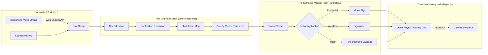
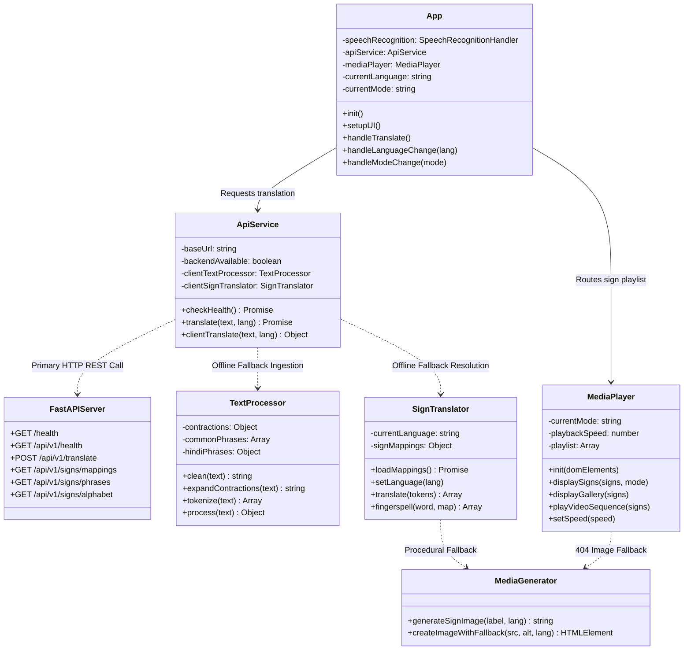

# 🧠 BRAIN.md — SignSpeak Master Cognitive Blueprint & System Architecture

> **The Definitive Developer & AI Agent Context File for the SignSpeak Project.**  
> *Everything you need to know about the architecture, mental model, algorithmic logic, data structures, and operational runbooks of SignSpeak.*

---

## 📑 Table of Contents
1. [Executive Mental Model & Philosophy](#1-executive-mental-model--philosophy)
2. [Component Synergy & Module Contracts](#2-component-synergy--module-contracts)
3. [Deep-Dive: The Processing Pipelines](#3-deep-dive-the-processing-pipelines)
   - [3.1 Sensory Acquisition (Speech & Text)](#31-sensory-acquisition-speech--text)
   - [3.2 Linguistic Engine (Normalization, Contractions, Transliteration, Greedy Tokenizer)](#32-linguistic-engine)
   - [3.3 Semantic Mapping & Fallback Cascade](#33-semantic-mapping--fallback-cascade)
   - [3.4 Motor Display & Playback Engine (Video Queue & Canvas Synthesis)](#34-motor-display--playback-engine)
4. [Data Dictionary & Media Contracts](#4-data-dictionary--media-contracts)
5. [Algorithmic Specifications & Mathematical Logic](#5-algorithmic-specifications--mathematical-logic)
6. [Operational Runbooks & Developer Playbook](#6-operational-runbooks--developer-playbook)
   - [6.1 Adding New Phrases and Signs](#61-adding-new-phrases-and-signs)
   - [6.2 Integrating a New Sign Dialect](#62-integrating-a-new-sign-dialect)
   - [6.3 Media Preparation Pipeline](#63-media-preparation-pipeline)
   - [6.4 Troubleshooting & Diagnostics](#64-troubleshooting--diagnostics)
7. [Cross-Reference & Ecosystem Links](#7-cross-reference--ecosystem-links)

---

## 1. Executive Mental Model & Philosophy

### 1.1 The "Why": Deterministic Accessibility
Modern AI interfaces often default to heavy, black-box deep neural networks (LLMs, Transformer video models, diffusion sign generators). While powerful, they present significant hurdles for assistive technology:
- **Hallucination Risk**: An LLM generating sign approximations can produce nonsensical or offensive hand gestures.
- **Latency & Resource Cost**: Real-time video diffusion or server inference requires GPUs, incurring 2–10 second latencies and cloud infrastructure bills.
- **Privacy Intrusion**: Transmitting microphone audio or sensitive user communication to third-party cloud servers violates confidentiality in medical, legal, or personal settings.

**SignSpeak** rejects this bloat. It is architected on **deterministic, rule-based, client-side algorithms**:
- **100% Deterministic**: Given input $X$, output gesture sequence $Y$ is always mathematically predictable.
- **Sub-50ms Execution**: Instantaneous local browser computation with zero remote inference round-trips.
- **Zero Dependencies**: Pure HTML5, CSS3, and ES6+ JavaScript modules. No Node.js runtime, no `npm install`, no bundlers.
- **Zero Privacy Leakage**: No audio streams or transcripts leave the client's device.

### 1.2 Cognitive Flow Diagram


---

## 2. Component Synergy & Module Contracts

The codebase is refactored into a decoupled, production-grade architecture featuring a modular ES6+ frontend, a high-performance Python FastAPI microservice, standalone ETL automation scripts, and an end-to-end automated test suite.

```
SignSpeak/
├── frontend/
│   ├── index.html                       # Semantic HTML5 User Interface
│   ├── assets/
│   │   ├── css/
│   │   │   └── styles.css               # Glassmorphic Design System & Responsive Tokens
│   │   ├── js/
│   │   │   ├── app.js                   # Application Lifecycle Coordinator
│   │   │   ├── components/
│   │   │   │   ├── mediaPlayer.js       # Video Playlist & Gallery Grid Presenter
│   │   │   │   ├── speechRecognition.js # Native Web Speech Audio Engine
│   │   │   │   └── mediaGenerator.js    # Procedural Canvas Fallback Badge Synthesis
│   │   │   ├── services/
│   │   │   │   ├── apiService.js        # Backend Gateway & Offline Failover Client
│   │   │   │   └── signTranslator.js    # Client-Side Fallback Translator & Resolver
│   │   │   └── utils/
│   │   │       ├── config.js            # Environment-aware Dynamic Configuration
│   │   │       └── textProcessor.js     # Text Cleaning, Contractions & Greedy Tokenizer
│   │   └── images/                      # Static branding and icon assets
│   └── public/
│       ├── data/
│       │   └── sign-mapping.json        # Client-accessible Sign Lexicon Registry
│       └── media/
│           ├── extracted/               # 13 Master demonstration phrase videos
│           └── signs/
│               └── asl/
│                   ├── alphabet/        # 26 Verified letter signs (a.jpg to z.jpg)
│                   └── phrases/         # 13 Phrase video clips (MP4 H.264)
├── backend/
│   ├── app/
│   │   ├── __init__.py
│   │   ├── main.py                      # FastAPI Application, Lifespan & Static Mounts
│   │   ├── api/
│   │   │   └── v1/
│   │   │       ├── health.py            # Health & Diagnostics Endpoints
│   │   │       ├── signs.py             # Sign Registry Discovery Endpoints
│   │   │       └── translate.py         # Deterministic Translation Endpoints
│   │   ├── models/
│   │   │   └── schemas.py               # Pydantic v2 Request/Response Schemas
│   │   ├── services/
│   │   │   ├── text_processor.py        # Python Rule-Based Tokenizer & Hindi Normalizer
│   │   │   └── translator_service.py    # Sign Mapping & Fingerspelling Engine
│   │   └── utils/
│   │       └── config.py                # Environment Config, CORS, Path Resolution
│   ├── tests/
│   │   ├── test_api.py                  # FastAPI Integration & Endpoint Verification
│   │   ├── test_text_processor.py       # Python NLP Tokenizer Unit Tests
│   │   └── test_translator_service.py   # Translation Service & Fallback Tests
│   └── requirements.txt                 # Backend Microservice Dependencies
├── data/
│   └── sign-mapping.json                # Single Source of Truth Sign Mapping Registry
├── scripts/
│   ├── convert_videos_to_images.py      # Video Frame Extraction Utility
│   ├── extract_asl.py                   # Kaggle ASL Alphabet Unpacker & Organizer
│   ├── organize_dataset.py              # Dataset Normalization Pipeline
│   ├── organize_videos.py               # Video Clip Path Synchronizer
│   ├── server.py                        # Standalone Python Dev Host (CORS Enabled)
│   └── setup_kaggle_dataset.py          # Kaggle Dataset Fetcher & Verifier
├── docs/
│   ├── PRD.md                           # Product Requirements Document
│   ├── TRD.md                           # Technical Requirements Document
│   ├── METHODOLOGY.md                   # Core Algorithmic Deep Dive
│   └── README.md                        # Documentation Hub Index
├── tests/
│   ├── __init__.py
│   └── test_e2e.py                      # End-to-End System Integrity & Asset Tests
├── pytest.ini                           # Pytest Importlib & Discovery Configuration
├── brain.md                             # Master Cognitive Blueprint (This Document)
├── .gitignore                           # Git Ignore Rules
├── .env.example                         # Environment Variables Template
└── README.md                            # Comprehensive Developer Guide & FAQ
```

### Module Responsibilities & Contracts



---

## 3. Deep-Dive: The Processing Pipelines

### 3.1 Sensory Acquisition (Speech & Text)
- **Source**: `js/speechRecognition.js`
- **Underlying Engine**: `window.SpeechRecognition` || `window.webkitSpeechRecognition`.
- **Operating Guarantees**:
  - Automatically verifies origins (`localhost` or `https:`). If launched from an insecure remote origin, safely disarms voice button and alerts user.
  - Emits real-time visual pulses (`.pulsing` CSS state on `#speechStatus`) to reassure users during voice capture.
  - Automatically normalizes intermediate speech chunks (`event.results[i][0].transcript`) before feeding to `#textInput`.

### 3.2 Linguistic Engine
- **Source**: `js/textProcessor.js`
- **Execution Order**:
  1. **Sanitization (`clean`)**:
     - Converts to lowercase: `text.toLowerCase()`.
     - Preserves English alphanumerics (`a-z0-9`), whitespace, and Hindi Devanagari Unicode block (`\u0900-\u097F`).
     - Removes extraneous punctuation and collapses redundant whitespace.
  2. **Contraction Expansion (`expandContractions`)**:
     - Evaluates 34 English contraction patterns (e.g., `can't` $\to$ `can not`, `it's` $\to$ `it is`).
     - Employs word-boundary regular expressions to prevent substring replacement errors.
  3. **Hindi Transliteration & Idiom Replacement**:
     - Detects transliterated Romanized Hindi phrases (e.g., `aapka naam kya hai`, `namaste`, `shukriya`).
     - Maps them directly to their canonical English equivalents (`what is your name`, `hello`, `thank you`).
  4. **Greedy Longest-Match Tokenizer (`tokenize`)**:
     - Phrases in `this.commonPhrases` are sorted by token count in descending order.
     - Performs sequential left-to-right scanning with greedy priority: matching multi-word phrases (e.g., `"good morning"`) before isolated words (`"good"`, `"morning"`).
     - Yields an array of structured token objects:
       ```javascript
       { type: 'phrase', value: 'good morning', words: ['good', 'morning'] }
       { type: 'word', value: 'everyone' }
       ```

### 3.3 Semantic Mapping & Fallback Cascade
- **Source**: `js/signTranslator.js`
- **Hierarchy of Resolution**:
  ```
  Step 1: Check Token Type
  ├── If 'phrase':
  │    ├── Query signMappings[lang][token.value]
  │    ├── HIT  -> Return Video Sign Object
  │    └── MISS -> Deconstruct into words -> Fall through to Step 2
  └── If 'word':
       ├── Query signMappings[lang][token.value]
       ├── HIT  -> Return Word Sign Object
       └── MISS -> Initiate Fingerspelling Cascade -> Split into characters (a-z)
                   ├── HIT  -> Return Alphabet Image Sign (media/signs/asl/alphabet/<char>.jpg)
                   └── MISS -> Route to MediaGenerator for procedural canvas synthesis
  ```

### 3.4 Motor Display & Playback Engine
- **Source**: `js/mediaPlayer.js` & `js/mediaGenerator.js`
- **Dual Presentation Capabilities**:
  - **Gallery Mode**:
    - Generates a responsive card grid (`.gallery-grid`).
    - Every token is presented as a distinct card with image, label, and type badge (`phrase`, `word`, `letter`).
    - Features CSS hover transformations (`transform: translateY(-4px)`).
  - **Video Mode (Continuous Sequencer)**:
    - Maintains an active playlist queue `this.playlist`.
    - Recursively advances via `playNext()`:
      - Videos: binds to native `video.addEventListener('ended', ..., { once: true })`.
      - Images: binds to dynamic timers calculated as $T = \frac{1500\text{ ms}}{\text{playbackSpeed}}$.
    - Playback speed changes via the UI slider (0.5x to 2.0x) apply instantaneously to both active videos (`video.playbackRate`) and timer intervals.

---

## 4. Data Dictionary & Media Contracts

### 4.1 `sign-mapping.json` Schema Contract
The primary configuration file resides at `data/sign-mapping.json`. It maps lexical keys to media resource objects.

```json
{
  "asl": {
    "<key>": {
      "type": "image" | "video",
      "path": "media/path/to/asset.ext",
      "generated": false | true
    }
  },
  "isl": {
    "<key>": {
      "type": "image" | "video",
      "path": "media/path/to/asset.ext",
      "generated": false | true
    }
  }
}
```

### 4.2 Asset Inventory Standards

| Category | Storage Path | Format | Dimensions / Encoding | Quantity |
| :--- | :--- | :--- | :--- | :--- |
| **Alphabet Signs** | `media/signs/asl/alphabet/<char>.jpg` | JPEG | Standardized square, high-contrast background | 26 (A–Z) |
| **Common Signs** | `media/signs/asl/common/<word>.png` | PNG | Synthetic or illustrated sign cards | Expandable |
| **Phrase Videos** | `media/signs/asl/phrases/<phrase>.mp4` | MP4 | H.264 Baseline, 720p/1080p, 24–30 fps | 13 primary |
| **Extracted Staging** | `media/extracted/*.mp4` | MP4 | Master repository of phrase clips | 13 primary |

### 4.3 Verified Video Phrase Roster
The following 13 video phrases are actively indexed and verified in `sign-mapping.json`:
1. `Good morning.mp4`
2. `Good Evening.mp4`
3. `Have a good day.mp4`
4. `How are you.mp4`
5. `What are you doing.mp4`
6. `what is your name.mp4`
7. `Monday.mp4`
8. `Tuesday.mp4`
9. `Wednesday.mp4`
10. `Thursday.mp4`
11. `Friday.mp4`
12. `Saturday.mp4`
13. `Sunday.mp4`

---

## 5. Algorithmic Specifications & Mathematical Logic

### 5.1 Greedy Longest-Match-First Pattern Matching
Given an input string $S$ normalized into a sequence of words $W = \langle w_1, w_2, \dots, w_n \rangle$:
1. Let $P = \{p_1, p_2, \dots, p_k\}$ be the set of registered multi-word idioms in `this.commonPhrases`.
2. Order $P$ such that $|p_i| \ge |p_{i+1}|$ where $|p|$ denotes word count.
3. For index $i = 1$ to $n$:
   - For each phrase $p \in P$ with length $m$:
     - If the sub-sequence $\langle w_i, \dots, w_{i+m-1} \rangle \equiv p$:
       - Emit token $T_{\text{phrase}}(p)$.
       - Advance index $i \leftarrow i + m$.
       - Break and continue.
   - If no phrase matches:
     - Emit token $T_{\text{word}}(w_i)$.
     - Advance index $i \leftarrow i + 1$.

```
Example:
Input: "Good morning to you and have a good day"
Phrases Available: ["good morning", "have a good day"]
1. Evaluates "good morning" -> MATCH -> Emits Phrase Token [good morning]
2. Evaluates "to" -> NO PHRASE MATCH -> Emits Word Token [to]
3. Evaluates "you" -> NO PHRASE MATCH -> Emits Word Token [you]
4. Evaluates "and" -> NO PHRASE MATCH -> Emits Word Token [and]
5. Evaluates "have a good day" -> MATCH -> Emits Phrase Token [have a good day]
```

### 5.2 Contraction Expansion Hash Table
Contains 34 deterministic mappings initialized at constructor execution:
```javascript
this.contractions = {
    "i'm": "i am", "you're": "you are", "he's": "he is",
    "she's": "she is", "it's": "it is", "we're": "we are",
    "they're": "they are", "isn't": "is not", "aren't": "are not",
    "wasn't": "was not", "weren't": "were not", "haven't": "have not",
    "hasn't": "has not", "hadn't": "had not", "won't": "will not",
    "wouldn't": "would not", "don't": "do not", "doesn't": "does not",
    "didn't": "did not", "can't": "can not", "couldn't": "could not",
    "shouldn't": "should not", "mightn't": "might not", "mustn't": "must not"
};
```

---

## 6. Operational Runbooks & Developer Playbook

### 6.1 Adding New Phrases and Signs

#### Step 1: Deposit the Media Asset
Place the video or image into the appropriate directory:
- For a phrase video: save as `media/signs/asl/phrases/<PhraseName>.mp4`
- For an individual word image: save as `media/signs/asl/common/<word>.png`

#### Step 2: Register in `js/textProcessor.js` (If Multi-Word)
If the sign represents a multi-word phrase (e.g., *"see you tomorrow"*), append it to `this.commonPhrases`:
```javascript
this.commonPhrases.push("see you tomorrow");
```

#### Step 3: Register in `data/sign-mapping.json`
Add the entry under the appropriate dialect (`"asl"` or `"isl"`):
```json
"see you tomorrow": {
  "type": "video",
  "path": "media/signs/asl/phrases/see_you_tomorrow.mp4",
  "generated": false
}
```

---

### 6.2 Integrating a New Sign Dialect (e.g., British Sign Language — BSL)

1. **Update UI**:
   In `index.html`, add the toggle button under `.language-selector`:
   ```html
   <button class="toggle-btn" data-lang="bsl" title="British Sign Language">
       🇬🇧 BSL
   </button>
   ```
2. **Update Lexicon**:
   In `data/sign-mapping.json`, add the top-level `"bsl"` key with alphabet and vocabulary definitions:
   ```json
   {
     "asl": { ... },
     "isl": { ... },
     "bsl": {
       "a": { "type": "image", "path": "media/signs/bsl/alphabet/a.jpg", "generated": false },
       ...
     }
   }
   ```
3. **Verify Routing**:
   In `js/signTranslator.js`, update `setLanguage(language)` to accept `'bsl'`.

---

### 6.3 Media Preparation Pipeline

SignSpeak provides five Python automation scripts in the `scripts/` directory:

```bash
# 1. Extract frames from demonstration videos as keyframe thumbnails
python scripts/convert_videos_to_images.py

# 2. Extract and organize Kaggle ASL Alphabet ZIP archives
python scripts/extract_asl.py

# 3. Synchronize video paths to frontend/public/media/signs/asl/phrases
python scripts/organize_videos.py

# 4. Automate Kaggle dataset setup
python scripts/setup_kaggle_dataset.py

# 5. Standalone zero-dependency development server (serves frontend/ directly)
python scripts/server.py
```

---

### 6.4 Operational Runbook: Running the Application

#### Option A: FastAPI Backend Microservice (Full Features & REST API)
```bash
# Install backend requirements
pip install -r backend/requirements.txt

# Launch FastAPI development server (auto-reloading on port 8000)
python -m uvicorn backend.app.main:app --host 0.0.0.0 --port 8000 --reload

# Or directly run:
python backend/app/main.py
```
- Interactive Swagger UI: `http://localhost:8000/docs`
- Health Check: `http://localhost:8000/health`
- Frontend UI: `http://localhost:8000/`

#### Option B: Standalone Frontend Client (100% Offline, Zero Backend)
```bash
# Serves frontend/ with CORS headers via Python standard library
python scripts/server.py
```
- Frontend UI: `http://localhost:8000/`
- Operates autonomously with client-side NLP and local media resolution.

---

### 6.5 Verification & Automated Test Suite

SignSpeak includes 24 automated unit, integration, and end-to-end tests:
```bash
# Execute entire test suite
python -m pytest -v
```

Test coverage includes:
1. `backend/tests/test_api.py`: FastAPI endpoints (`/health`, `/api/v1/translate`, `/api/v1/signs/*`, input validation, and Hindi transliteration).
2. `backend/tests/test_text_processor.py`: Text cleaning, contraction expansion, Hindi transliteration, and greedy phrase tokenization.
3. `backend/tests/test_translator_service.py`: Lexicon resolution, fingerspelling cascade, and path normalization.
4. `tests/test_e2e.py`: Project structure completeness, lexicon integrity, alphabet image assets, phrase video clips, and FastAPI static asset serving.

---

### 6.6 Troubleshooting & Diagnostics

| Symptom | Root Cause | Resolution |
| :--- | :--- | :--- |
| **Voice button non-responsive / throws permission error** | Web Speech API blocked due to insecure origin | Launch via `python -m uvicorn backend.app.main:app` or `python scripts/server.py` and open `http://localhost:8000` (not `file://`). |
| **Video does not play or shows black box** | Incompatible video codec profile | Re-encode video using FFmpeg: `ffmpeg -i input.mp4 -vcodec h264 -acodec aac output.mp4`. |
| **Missing sign displays placeholder canvas badge** | Media file path missing on disk or 404 | Expected graceful degradation. Verify file path in `data/sign-mapping.json`. |
| **Backend API offline warning in console** | FastAPI server is not currently running | Expected failover: SignSpeak automatically cascades to client-side rule engine without breaking user experience. |
| **CORS errors in developer console** | Using an external dev server origin | Add your dev port (e.g. `http://localhost:3000`) to `CORS_ORIGINS` in `.env`. |

---

## 7. Cross-Reference & Ecosystem Links

- **Product Requirements Document**: [docs/PRD.md](file:///c:/Users/hp/OneDrive/Desktop/1/SignSpeak/docs/PRD.md)
- **Technical Requirements Document**: [docs/TRD.md](file:///c:/Users/hp/OneDrive/Desktop/1/SignSpeak/docs/TRD.md)
- **Methodology & Architectural Deep Dive**: [docs/METHODOLOGY.md](file:///c:/Users/hp/OneDrive/Desktop/1/SignSpeak/docs/METHODOLOGY.md)
- **Documentation Hub Index**: [docs/README.md](file:///c:/Users/hp/OneDrive/Desktop/1/SignSpeak/docs/README.md)
- **User Guide & FAQs**: [README.md](file:///c:/Users/hp/OneDrive/Desktop/1/SignSpeak/README.md)

---

## 8. Extensible ASL Model Training & Recognition Platform (v2.1 Architecture)

### 8.1 System Overview
Upgrading SignSpeak from deterministic speech-to-sign playback to a dual-capability platform:
1. **Continuous Real-Time Webcam ASL Recognition**: Live video landmark extraction (MediaPipe Holistic/Hands), temporal sequence classification, continuous gloss recognition, and sentence-level translation.
2. **Modular Dataset & Training Pipeline**: Dataset-agnostic adapters (How2Sign, WLASL, MS-ASL, Custom), versioned manifests, configurable model training, checkpoint validation, evaluation metrics, and local model registry.
3. **Training & Management Dashboard**: Web-based model selection, dataset inspection, training lifecycle monitoring, evaluation comparison, and deployment to the live webcam recognition interface.

### 8.2 Hardware & Environment Baseline (Audited Phase 1)
- **OS**: Windows 11 (win32)
- **Python**: 3.11.9
- **PyTorch**: 2.9.1+cpu (CUDA Available: False, optimized for CPU execution)
- **MediaPipe**: 0.10.21 (real-time hand/pose landmark estimation)
- **OpenCV**: 4.11.0
- **FastAPI**: 0.104.1 / Uvicorn: 0.24.0 / Pydantic: 2.12.5
- **System RAM**: 15.84 GB Total (~6.33 GB Free)
- **Disk Space**: 68.6 GB Available
- **Design Strategy**: Landmark-based temporal feature vectors (compact, sub-30ms CPU inference) with bounded sequence buffering and CTC / Seq2Seq decoders.

### 8.3 Implementation Phase Tracker
- [x] **Phase 1: Audit repository and hardware** (Clean working tree, 24/24 baseline tests pass, hardware capability mapped: 15.8GB RAM, PyTorch 2.9.1+cpu, MediaPipe 0.10.21, OpenCV 4.11.0).
- [x] **Phase 2: Common dataset interface & custom dataset adapter** (Abstract `DatasetAdapter`, `NormalizedSample`, `DatasetManifest`, `ValidationReport`, `CustomDatasetAdapter` with directory, CSV, and JSON parsing).
- [x] **Phase 3: Real dataset adapters (How2Sign, WLASL, MS-ASL)** (Official schemas, license verification, split preservation, signer leakage detection, 8 comprehensive tests passing).
- [x] **Phase 4: Isolated-sign baseline & training/evaluation pipeline (Task A)** (LandmarkExtractor 144-dim, sequence resampling/normalization, Vocabulary, BiGRU-Attention IsolatedSignClassifier, IsolatedSignTrainer, ModelEvaluator, metrics with confusion matrix & latency).
- [x] **Phase 5: Continuous gloss recognition (Task B) & sentence translation (Task C)** (ContinuousGlossRecognizer with PyTorch CTCLoss & greedy path decoding, ContinuousGlossTrainer, GlossToEnglishTranslator with ASL question-inversion and copula synthesis, SignTranslationPipeline, WER/BLEU/chrF metrics).
- [x] **Phase 6: Model registry & task compatibility checks** (LocalModelRegistry, RegisteredModelInfo, SHA-256 checksum verification, CheckpointVerificationError, IncompatibleTaskError enforcement, default task configuration files).
- [x] **Phase 7: Live webcam recognition & transcript streaming interface** (WebcamRecognitionHandler, bounded sliding buffer in RecognitionService, real-time landmark canvas overlay, partial and finalized transcripts, camera permission states, model selector).
- [x] **Phase 8: Frontend dataset & model training dashboard** (TrainingDashboardHandler, validation cards, sample counts, train/val/test splits, signer leakage alerts, configurable hyperparameters, live terminal logs, model registry table, one-click deploy).
- [x] **Phase 9: End-to-end integration tests & operational documentation** (52 automated tests passing, unified CLI `scripts/pipeline_cli.py`, updated PRD/TRD/README).

### 8.4 ML Platform CLI Runbook
```bash
# 1. Inspect supported dataset adapter contracts
python scripts/pipeline_cli.py inspect --dataset how2sign
python scripts/pipeline_cli.py inspect --dataset wlasl
python scripts/pipeline_cli.py inspect --dataset custom

# 2. Validate a local dataset directory (without downloading heavy assets)
python scripts/pipeline_cli.py validate --dataset custom --path data/

# 3. Build a versioned manifest
python scripts/pipeline_cli.py manifest --dataset custom --path data/ --output data/manifests/custom_isolated.json --task isolated_sign

# 4. Train a model from a config file
python scripts/pipeline_cli.py train --config ml/configs/task_a_isolated_default.json

# 5. List registered models in local registry
python scripts/pipeline_cli.py models

# 6. Start full web application (FastAPI + Webcam UI + Training Dashboard)
python -m uvicorn backend.app.main:app --host 127.0.0.1 --port 8000 --reload
# Or via CLI:
python scripts/pipeline_cli.py serve --port 8000
```

