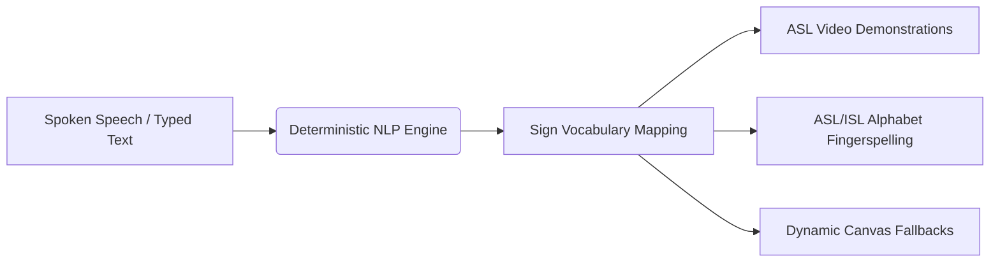
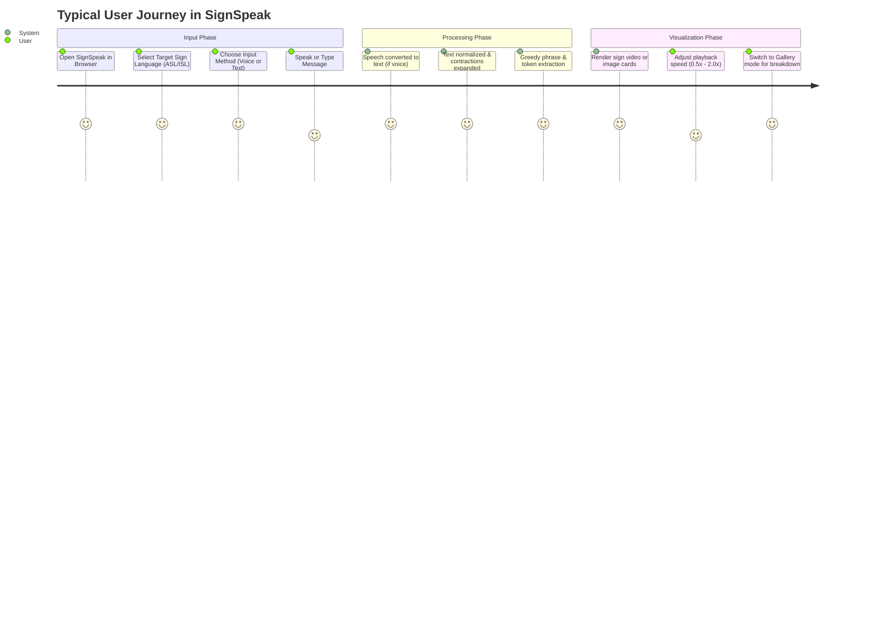
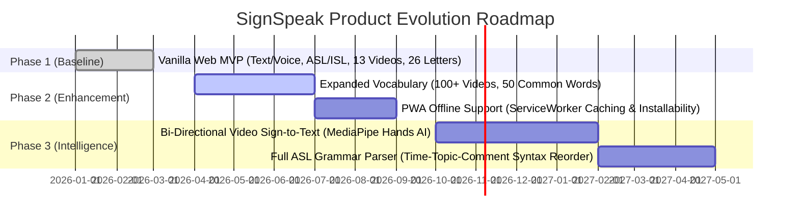

# Product Requirements Document (PRD) — SignSpeak

---

## Document Metadata
- **Project Name**: SignSpeak
- **Document Version**: 1.0.0
- **Status**: Approved & Baselined
- **Target Audience**: Product Managers, Software Engineers, Accessibility Specialists, UI/UX Designers, Open Source Contributors
- **Product Classification**: Assistive Technology / Client-Side Web Application

---

## 1. Executive Summary & Product Vision

### 1.1 Executive Summary
**SignSpeak** is a high-accessibility, client-side web application engineered to bridge the communication chasm between spoken/written language and sign language. The application captures voice input via the browser's native Web Speech API or accepts direct keyboard text entry in both English and Hindi, normalizes and tokenizes the message via a deterministic rule-based processing engine, and translates the linguistic tokens into high-fidelity American Sign Language (ASL) and Indian Sign Language (ISL) visual demonstrations (MP4 videos and JPG/PNG image sequences).

Operating with **zero external machine learning dependencies, zero build pipelines, and zero user data transmission**, SignSpeak provides a real-time, privacy-preserving, and offline-capable assistive interface.

### 1.2 Product Vision
To democratize digital accessibility by delivering an instantaneous, frictionless, zero-install bridge to sign language that runs in any standard web browser on any device, guaranteeing user privacy while fostering inclusive communication in educational, healthcare, customer service, and daily social environments.

### 1.3 Core Tenets
1. **Accessibility First**: Designed with high contrast, legible typography, visual status indicators, and keyboard-friendly interactions.
2. **Absolute Privacy**: No audio or text logs leave the user's local browser environment; no third-party cloud LLMs or telemetry servers are consulted.
3. **Deterministic Reliability**: Consistent, reproducible translations achieved through verified linguistic dictionaries and greedy rule-based pattern matching.
4. **Zero-Friction Deployment**: Runs purely on static web standards (HTML5/CSS3/ES6+ JavaScript) without Node.js dependencies, npm packages, or compilation steps.
5. **Graceful Degradation**: When dedicated sign videos or vocabulary images are unavailable, the system cascades seamlessly into letter-by-letter fingerspelling or synthetic HTML5 Canvas cards.

---

## 2. Problem Statement & Market Opportunity

### 2.1 The Problem
- **Communication Barriers**: Over 70 million Deaf people globally utilize sign language as their primary mode of communication (World Federation of the Deaf). Hearing individuals rarely possess sign fluency, resulting in severe friction in essential interactions (clinics, public transit, retail, government offices).
- **Complexity and Latency of Heavy AI Solutions**: Existing AI sign language models frequently require bulky backend servers, GPU clusters, high-bandwidth streaming, or cloud APIs that incur latency, operational cost, and privacy vulnerabilities.
- **Under-Representation of Regional Sign Languages**: While ASL enjoys moderate digital tooling, Indian Sign Language (ISL) and Hindi bilingual speakers face a severe shortage of localized assistive tools.

### 2.2 Market Opportunity & Value Proposition
SignSpeak addresses this gap by offering:
- **Instant Client-Side Execution**: Sub-50ms token translation latency without remote server round-trips.
- **Bilingual & Dual-Dialect Support**: Supports both English and transliterated Hindi phrases mapped to ASL and ISL visual representations.
- **Dual Visual Presentation Modes**: Switchable Video playback mode (for contextual gestures and continuous phrases) and Gallery card mode (for educational study and sequential review).

---

## 3. User Personas & Target Audience

| Persona | Role / Profile | Pain Points | Primary SignSpeak Value |
| :--- | :--- | :--- | :--- |
| **P1: Hearing Interactor (Elena)** | Customer service agent or nurse with no sign language knowledge. | Needs to communicate emergency or transactional instructions quickly without an interpreter present. | Instant voice input converts spoken instructions into clear sign demonstrations on-screen. |
| **P2: Sign Language Learner (Aarav)** | Student studying ASL and ISL. | Struggling to remember fingerspelling for unfamiliar names and specific common greeting phrases. | Interactive Gallery mode and adjustable video playback speeds (0.5x to 2.0x) allow frame-by-frame study. |
| **P3: Deaf / Hard-of-Hearing (Maya)** | ASL communicator in bilingual English/Hindi environments. | Faces difficulty reading lips in noisy spaces or through digital interfaces lacking sign cues. | Provides visual sign confirmation alongside spoken transcripts for shared mutual understanding. |
| **P4: Low-Resource Educator (Rajesh)** | Special education teacher with limited classroom hardware and erratic internet. | Cannot rely on heavy GPU apps or paid cloud AI subscriptions. | Zero-dependency, offline-capable architecture operable off a simple local Python dev server or static host. |

---

## 4. User Journey & Core Use Cases

### 4.1 Use Case 1: Real-Time Spoken Conversation Translation
- **Actor**: Hearing user speaking into laptop or mobile microphone.
- **Precondition**: Browser grants microphone permission via HTTPS or localhost.
- **Flow**:
  1. User selects target dialect (ASL or ISL).
  2. User clicks the `🎤 Voice Input` button.
  3. Visual pulsating indicator confirms active listening state.
  4. User speaks: *"Good morning, what is your name?"*
  5. Browser fires SpeechRecognition result events, streaming text into the text area.
  6. User clicks `Translate to Signs`.
  7. System decomposes the sentence into phrase tokens `good morning` and `what is your name`.
  8. System sequentially streams the corresponding high-resolution MP4 video demonstrations.

### 4.2 Use Case 2: Hindi Conversational Transliteration to ISL
- **Actor**: Hindi speaker communicating in an Indian context.
- **Flow**:
  1. User toggles `🇮🇳 ISL`.
  2. User enters Romanized Hindi phrase: *"Aapka naam kya hai"*.
  3. Processing engine translates the Hindi idiom to its semantic equivalent: *"what is your name"*.
  4. System renders the corresponding sign demonstration without requiring manual English re-typing.

### 4.3 Use Case 3: Fingerspelling Decomposition for Unmapped Terms
- **Actor**: User inputting a proper noun (e.g., *"Alex"*).
- **Flow**:
  1. System checks `sign-mapping.json` for token `"alex"`.
  2. No full-phrase or whole-word match found.
  3. System initiates fallback fingerspelling cascade: splits string into characters `['a', 'l', 'e', 'x']`.
  4. Maps each character to `media/signs/asl/alphabet/<char>.jpg`.
  5. In Gallery mode: displays cards sequentially labeled with letter tags.
  6. In Video mode: displays consecutive visual transitions or synthesized cards.

---

## 5. Functional Requirements (FR)

### 5.1 Input Subsystem
- **FR-1.1 Speech Recognition**: The application MUST integrate the Web Speech API (`SpeechRecognition` / `webkitSpeechRecognition`) to convert live microphone audio into text without external API calls.
- **FR-1.2 Real-time Visual Status**: The UI MUST display clear visual feedback (pulsing indicator and text state) showing when listening is active, paused, or terminated.
- **FR-1.3 Text Area Input**: The UI MUST provide an interactive textarea supporting freeform multiline English and Unicode Hindi text input.
- **FR-1.4 One-Click Clearance**: A dedicated `Clear` control MUST reset text areas, clear active media players, and return output containers to their default placeholder state.

### 5.2 Language & Text Processing Subsystem
- **FR-2.1 Text Normalization**: Input MUST be converted to lowercase, stripped of extraneous punctuation, and trimmed of excessive whitespace while preserving alphanumerics.
- **FR-2.2 Contraction Expansion**: The text engine MUST expand common English contractions (e.g., *"don't"* $\to$ *"do not"*, *"i'm"* $\to$ *"i am"*, *"you're"* $\to$ *"you are"*).
- **FR-2.3 Hindi-to-English Idiom Mapping**: The system MUST map at least 20 common conversational Hindi expressions (e.g., *"namaste"* $\to$ *"hello"*, *"shukriya"* $\to$ *"thank you"*, *"aap kaise hain"* $\to$ *"how are you"*) to their canonical sign targets.
- **FR-2.4 Greedy Phrase Tokenization**: The engine MUST evaluate multi-word phrases using a longest-match-first strategy before falling back to individual words, ensuring idioms like *"good morning"* are not split into distinct signs for *"good"* and *"morning"*.
- **FR-2.5 Fingerspelling Fallback**: Unrecognized vocabulary words MUST be recursively broken down into character tokens corresponding to alphabet signs (A–Z).

### 5.3 Translation & Media Mapping Subsystem
- **FR-3.1 Dual Dialect Selection**: Users MUST be able to toggle between American Sign Language (ASL) and Indian Sign Language (ISL).
- **FR-3.2 Static JSON Asset Registry**: Sign mappings MUST be declared in an external, human-readable configuration file (`data/sign-mapping.json`).
- **FR-3.3 Heterogeneous Asset Support**: The system MUST support both MP4 video media and JPG/PNG image assets within the same translation sequence.
- **FR-3.4 Dynamic Fallback Generation**: If a mapped asset file fails to load or does not exist on disk, the system MUST dynamically render an HTML5 Canvas fallback badge featuring the token label, icon, and language badge.

### 5.4 Presentation & Playback Subsystem
- **FR-4.1 Dual Presentation Modes**:
  - **Video Mode**: Renders signs sequentially in an HTML5 video player with continuous playlist progression.
  - **Gallery Mode**: Renders signs simultaneously in a responsive flex/grid layout showing all signs in sequential sentence order.
- **FR-4.2 Video Playback Controls**: Video mode MUST include standard controls (Play, Pause) and an adjustable playback speed slider (0.5x, 0.75x, 1.0x, 1.25x, 1.5x, 2.0x).
- **FR-4.3 Progress & Status Tracking**: The UI MUST indicate translation processing progress and display sign cues.
- **FR-4.4 Modal Information System**: The application MUST include an accessible "About SignSpeak" modal window detailing features, supported dialects, and usage guidelines.

---

## 6. Non-Functional Requirements (NFR)

### 6.1 Performance & Latency
- **NFR-1.1 Tokenization Latency**: Text processing and tokenization for inputs up to 500 characters MUST complete in under **10 milliseconds** on standard client hardware.
- **NFR-1.2 End-to-End Translation Time**: From the moment the user clicks "Translate" to initial media render, execution MUST not exceed **100 milliseconds** (excluding external network video loading times).
- **NFR-1.3 Initial Page Load**: Total core asset bundle (HTML, CSS, JS) MUST remain under **100 KB** compressed, achieving First Contentful Paint (FCP) within **1.0 second** on standard broadband.

### 6.2 Privacy & Security
- **NFR-2.1 Zero Remote Data Exfiltration**: Audio streams and processed text MUST NOT be transmitted to any third-party server, tracking service, or cloud storage.
- **NFR-2.2 Localhost & HTTPS Compliance**: Microphones MUST strictly operate under secure browser origins (`https://` or `http://localhost`).
- **NFR-2.3 Zero Dependency Risk**: The production runtime MUST maintain zero `node_modules` and zero CDN script dependencies, eliminating software supply-chain vulnerabilities.

### 6.3 Usability, Accessibility & Compatibility
- **NFR-3.1 Browser Support**: Fully operational on modern evergreen browsers supporting ES6 modules and Web Speech API:
  - Google Chrome $\ge$ 80
  - Microsoft Edge $\ge$ 80
  - Safari $\ge$ 14.1 (with SpeechRecognition support)
  - Mozilla Firefox (fallback to manual text entry where Web Speech API is restricted)
- **NFR-3.2 Responsive Design**: Layout MUST adapt seamlessly across desktop monitors (1920x1080), laptops (1366x768), tablets (768x1024), and mobile viewports (375x667).
- **NFR-3.3 Contrast & Readability**: Dark theme styling MUST conform to WCAG 2.1 AA standards with minimum contrast ratios of 4.5:1 for body copy and 3:1 for interactive controls.

---

## 7. Data & Asset Requirements

### 7.1 Dataset Standards
- **Alphabet Asset Set**: 26 alphabet images (A–Z) formatted as high-contrast JPGs derived from verified ASL datasets.
- **Phrase Video Set**: High-definition MP4 videos encoded with H.264 video codec and AAC audio (or silent) for maximum cross-browser hardware acceleration.
- **Mapping File**: Valid UTF-8 encoded JSON schema mapping keys to media paths and metadata.

---

## 8. Success Metrics & Key Performance Indicators (KPIs)

| Metric | Target | Measurement Method |
| :--- | :--- | :--- |
| **Speech-to-Text Accuracy** | $\ge 90\%$ in quiet environments | Browser Web Speech native recognition logs |
| **Token Translation Coverage** | $100\%$ determinism | Fallback to alphabet fingerspelling for any unmapped token |
| **Client Translation Latency** | $< 50\text{ ms}$ | Performance API marks (`performance.now()`) |
| **Client-Side Crash / Uncaught Errors** | $0$ fatal exceptions | Window `error` and `unhandledrejection` telemetry |
| **Storage Footprint** | $< 50\text{ MB}$ total media payload | Local file size audit of `media/` assets |

---

## 9. Assumptions, Dependencies & Constraints

### 9.1 Assumptions
- Users have access to a standard microphone when utilizing voice input mode.
- Users understand basic written English or Romanized Hindi phrases.
- Browser environment permits ES6 module loading (`type="module"`).

### 9.2 Dependencies
- Native browser Web Speech API.
- Native browser HTML5 `<video>` and `<canvas>` engine.
- Python 3.8+ for local development hosting via `server.py`.

### 9.3 Constraints
- Web Speech API requires an active internet connection in Google Chrome (for Google's speech recognition servers) unless offline speech packs are installed in the host OS.
- Sign language grammar (spatial syntax and non-manual facial markers) is currently approximated using English Subject-Verb-Object (SVO) order rather than full ASL/ISL spatial grammar.

---

## 10. Product Roadmap & Future Horizons

- **Phase 1 (Current Release)**: Pure client-side baseline, voice/text input, greedy tokenization, ASL/ISL mappings, 13 video phrases, 26 alphabet images, HTML5 Canvas fallback.
- **Phase 2 (Near Term)**: Progressive Web App (PWA) manifest and Service Worker for 100% offline playback of pre-cached video assets; expanded vocabulary covering 100+ daily conversational signs.
- **Phase 3 (Long Term)**: Two-way communication using client-side WebAssembly / MediaPipe Hands to detect user gestures via webcam and translate sign gestures back into spoken audio/text.
