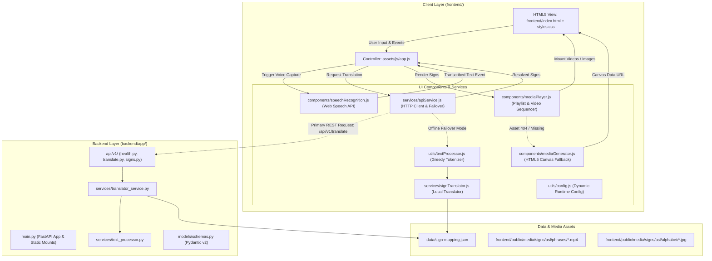
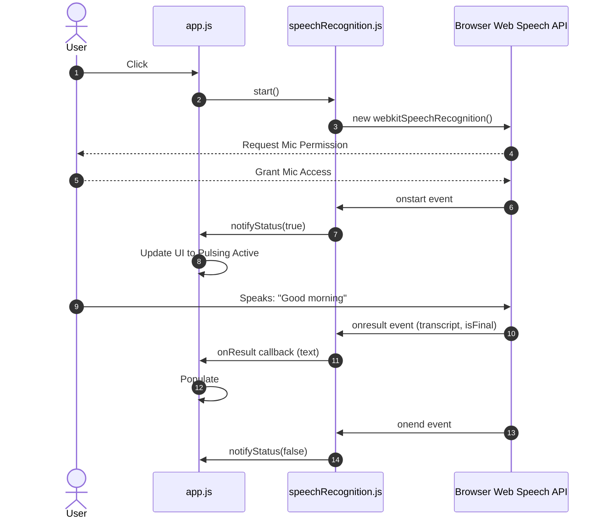
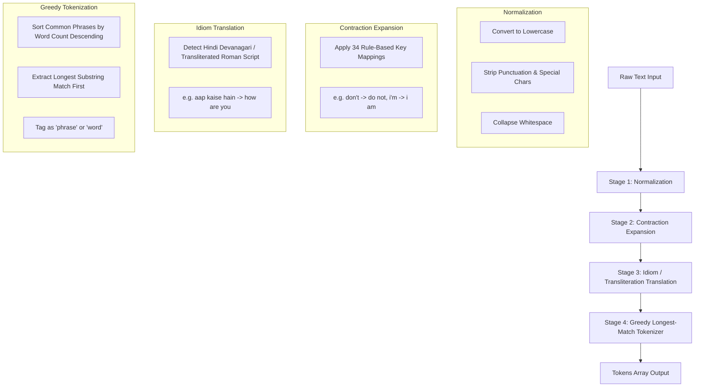
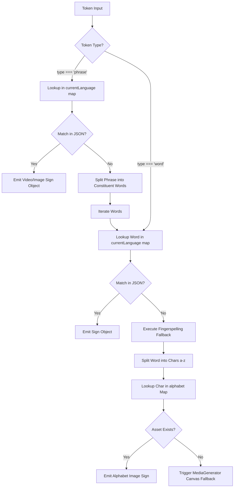

# Technical Requirements Document (TRD) — SignSpeak

---

## Document Metadata
- **Project Name**: SignSpeak
- **Document Version**: 1.0.0
- **Status**: Baselined & Production-Ready
- **Primary Authors**: Lead Architect & Systems Engineer
- **Target Audience**: Frontend Engineers, Full-Stack Developers, DevOps/Release Engineers, Security Auditors
- **Repository Location**: `https://github.com/kayum0134s/SignSpeak.git`

---

## 1. System Architecture & High-Level Design

### 1.1 Architecture Pattern
SignSpeak implements a decoupled, professional full-stack architecture composed of:
1. **Frontend Layer**: Modular ES6+ Single Page Application with Vanilla HTML5/CSS3 (Glassmorphism), organized into distinct components, services, and utilities with zero npm dependencies.
2. **Backend Microservice Layer**: High-performance Python FastAPI service providing OpenAPI documentation, structured REST endpoints (`/health`, `/api/v1/translate`, `/api/v1/signs/*`), CORS middleware, and static asset delivery.
3. **Autonomous Offline Resilience**: Client-side fallback translation engine that guarantees 100% operational functionality even when the backend is offline or unreachable.



### 1.2 Module Dependency Matrix

| Module | Source Location | Responsibilities | Upstream Dependencies | Downstream Consumers |
| :--- | :--- | :--- | :--- | :--- |
| **App Coordinator** | `frontend/assets/js/app.js` | UI binding, event coordination, state lifecycle, playback orchestrator | All frontend modules | DOM (`index.html`) |
| **API Service** | `frontend/assets/js/services/apiService.js` | Backend HTTP communication, health check, autonomous client failover | Fetch API, `config.js` | `app.js` |
| **Speech Engine** | `frontend/assets/js/components/speechRecognition.js` | Web Speech API wrapper, audio capture, event broadcasting | Web Speech API | `app.js` |
| **Media Player** | `frontend/assets/js/components/mediaPlayer.js` | Video playlist sequencing, speed regulation, DOM card grid rendering | HTML5 `<video>`, Canvas | `app.js` |
| **Media Generator** | `frontend/assets/js/components/mediaGenerator.js` | Procedural HTML5 Canvas badge rendering for missing sign assets | Canvas 2D API | `mediaPlayer.js` |
| **Client Translator** | `frontend/assets/js/services/signTranslator.js` | Client-side dictionary resolution, dialect routing (ASL/ISL), fingerspelling | `sign-mapping.json` | `apiService.js` |
| **Client Text Processor** | `frontend/assets/js/utils/textProcessor.js` | Normalization, regex cleaning, contraction expansion, greedy phrase matching | Pure ECMAScript | `apiService.js` |
| **FastAPI Microservice** | `backend/app/main.py` | REST API routes, static file mounts (`/`, `/assets`, `/public`, `/data`) | FastAPI, Uvicorn | Web Clients |
| **Backend Translation Service** | `backend/app/services/translator_service.py` | Server-side sign resolution, path normalization, fingerspelling fallback | `sign-mapping.json` | `translate.py` |
| **Backend Text Processor** | `backend/app/services/text_processor.py` | Server-side greedy tokenization, contraction dictionary, Hindi transliteration | Python 3 standard library | `translator_service.py` |


---

## 2. Technical Stack & Hardware/Software Specifications

### 2.1 Software Stack Specification

| Tier | Component | Version / Specification | Rationale |
| :--- | :--- | :--- | :--- |
| **Markup** | HTML5 | Living Standard (Semantic HTML5) | Native accessibility, video controls, no virtual DOM overhead |
| **Styling** | Vanilla CSS3 | Custom Properties, Grid, Flexbox, Glassmorphism | Zero compile step, high-performance GPU compositing |
| **Runtime** | JavaScript | ECMAScript 2020+ (Native ES Modules) | Clean module separation via `import`/`export`, native `async/await` |
| **Voice Processing** | Web Speech API | `webkitSpeechRecognition` / `SpeechRecognition` | Zero-latency browser-native voice-to-text without cloud API fees |
| **Graphic Rendering**| Canvas 2D API | HTML5 Canvas Context 2D | Synthetic graphic generation on the fly for missing media assets |
| **Media Codec** | H.264 / AAC | MP4 Container, Baseline Profile $\le 4.1$ | Universally supported across iOS Safari, Chromium, and Firefox |
| **Image Standard** | JPEG / PNG | Progressive JPEG, 8-bit depth, sRGB | Compact size, rapid decoding pipeline |
| **Server Runtime** | Python | 3.8+ (`http.server`, `socketserver`) | Zero-install development host present on virtually all OS environments |
| **CV Toolkit** | OpenCV (`cv2`) | $\ge 4.8.0$ (Optional utility script) | Video-to-image dataset processing (`convert_videos_to_images.py`) |

### 2.2 System & Environmental Requirements
- **Server Platform**: Any OS running Python 3.8+ (Windows 10/11, macOS 11+, Ubuntu 20.04+).
- **Client System**:
  - Memory: $\ge 2\text{ GB}$ RAM available.
  - CPU: Dual-Core $1.5\text{ GHz}$ or higher.
  - Video Subsystem: Hardware-accelerated H.264 decoding recommended.
  - Audio Hardware: Microphone input interface.
  - Network: Required only for initial asset fetch or Google Chrome speech server handshake; local static execution is offline-capable.

---

## 3. Data Architecture & Schema Specifications

### 3.1 Sign Mapping Registry Schema (`data/sign-mapping.json`)
The application relies on a declarative JSON schema defining the mapping between normalized tokens and their corresponding visual assets.

#### Formal JSON Schema Definition:
```json
{
  "$schema": "http://json-schema.org/draft-07/schema#",
  "title": "SignMappingConfig",
  "type": "object",
  "properties": {
    "asl": {
      "type": "object",
      "additionalProperties": { "$ref": "#/definitions/SignDescriptor" }
    },
    "isl": {
      "type": "object",
      "additionalProperties": { "$ref": "#/definitions/SignDescriptor" }
    }
  },
  "required": ["asl", "isl"],
  "definitions": {
    "SignDescriptor": {
      "type": "object",
      "properties": {
        "type": {
          "type": "string",
          "enum": ["image", "video"]
        },
        "path": {
          "type": "string"
        },
        "generated": {
          "type": "boolean"
        }
      },
      "required": ["type", "path", "generated"]
    }
  }
}
```

#### Asset Mapping Example:
```json
{
  "asl": {
    "a": {
      "type": "image",
      "path": "media/signs/asl/alphabet/a.jpg",
      "generated": false
    },
    "good morning": {
      "type": "video",
      "path": "media/signs/asl/phrases/Good morning.mp4",
      "generated": false
    },
    "water": {
      "type": "image",
      "path": "media/signs/asl/common/water.png",
      "generated": true
    }
  }
}
```

### 3.2 Directory & Media Storage Structure
```
SignSpeak/
├── data/
│   └── sign-mapping.json             # Core mapping registry
├── media/
│   ├── extracted/                    # Master extracted phrase video clips
│   │   ├── Friday.mp4
│   │   ├── Good morning.mp4
│   │   └── ... (13 videos)
│   └── signs/
│       └── asl/
│           ├── alphabet/             # Letter image assets (a.jpg to z.jpg)
│           ├── common/               # Single-word sign images
│           └── phrases/              # Copied phrase video clips
```

---

## 4. Algorithmic Processing Pipelines

### 4.1 Speech-to-Text Pipeline (`speechRecognition.js`)
The voice acquisition layer wraps `window.webkitSpeechRecognition` with event lifecycle handlers and browser polyfills:



#### Exception Handling & Protocol Guards:
- **Origin Guard**: If `window.location.protocol !== 'https:' && window.location.hostname !== 'localhost'`, browser will reject mic access. UI surfaces an alert instructing user to run through `http://localhost:8000`.
- **API Availability**: If `webkitSpeechRecognition` and `SpeechRecognition` are both undefined, UI disables the voice button and defaults gracefully to keyboard entry.

---

### 4.2 Natural Language Processing Pipeline (`textProcessor.js`)

The text processor operates deterministically in three sequential stages:



#### Mathematical & Algorithmic Complexity:
- **Text Cleaning**: $\mathcal{O}(L)$ where $L$ is input character length.
- **Contraction Replacement**: $\mathcal{O}(K \cdot L)$ where $K = 34$ contraction rules.
- **Greedy Phrase Matching**: Let $N$ be the number of words in the normalized sentence and $M$ be the number of registered multi-word phrases ($M = 20$). The algorithm sorts phrases by descending token length and searches via index matching:
  $$\text{Time Complexity} = \mathcal{O}(N \times M)$$
  Given $N \le 100$ and $M = 20$, worst-case execution is negligible ($< 1\text{ ms}$).

---

### 4.3 Translation & Fallback Hierarchy (`signTranslator.js`)

When resolving tokens against `sign-mapping.json`, the translator executes an explicit fallback cascade:



---

### 4.4 Media Playback & Synthetic Generation (`mediaPlayer.js` & `mediaGenerator.js`)

#### 4.4.1 Video Sequential Playlist Engine
In **Video Mode**, multiple signs (e.g., phrases or words) are played consecutively without requiring user intervention:
1. An internal array `this.playlist` stores sign objects.
2. `playNext()` dequeues the head sign.
3. If the sign is an MP4 video:
   - Sets `signVideo.src = sign.path`.
   - Applies the selected playback rate: `signVideo.playbackRate = this.playbackSpeed`.
   - Attaches a one-time `'ended'` event listener to trigger the subsequent item in the queue.
4. If the sign is an image:
   - Mounts the image into the view with a configurable display duration timer ($1500\text{ ms} \times \frac{1}{\text{speed}}$).
   - Once the timer elapses, calls `playNext()`.

#### 4.4.2 Canvas Dynamic Fallback Engine (`mediaGenerator.js`)
When an image asset path fails or represents an unmapped token:
```javascript
const canvas = document.createElement('canvas');
canvas.width = 300;
canvas.height = 300;
const ctx = canvas.getContext('2d');
// Generates gradient background, token label text, sign icon, and language badge
return canvas.toDataURL('image/png');
```

---

---

## 5. Backend Server Architecture (`backend/app/main.py`)

SignSpeak incorporates a Python FastAPI microservice that serves REST API endpoints, provides interactive OpenAPI documentation (`/docs`), enforces secure CORS policies, and mounts static frontend and media assets.

### 5.1 REST API Contracts & Endpoint Specification

| Method | Endpoint | Description | Request Payload | Response Schema |
| :--- | :--- | :--- | :--- | :--- |
| **GET** | `/health` | Root health diagnostic check | None | `HealthResponse` (`status`, `version`, sign counts) |
| **GET** | `/api/v1/health` | API v1 health and system status | None | `HealthResponse` |
| **POST** | `/api/v1/translate` | Translate text into sign media objects | `TranslateRequest` (`text`, `language`) | `TranslateResponse` (`tokens`, `signs`, `source`) |
| **GET** | `/api/v1/signs/mappings` | Query dictionary mappings for dialect | Query param `language=asl\|isl` | Object (`language`, `total_signs`, `signs`) |
| **GET** | `/api/v1/signs/phrases` | Query multi-word video phrase roster | Query param `language=asl\|isl` | Object (`language`, `count`, `phrases`) |
| **GET** | `/api/v1/signs/alphabet` | Query 26 alphabet letter image mappings | Query param `language=asl\|isl` | Object (`language`, `alphabet`) |

### 5.2 Static File Mounts & Content Delivery
- **`/`**: Serves `frontend/index.html` via `FileResponse`.
- **`/assets`**: Mounts `frontend/assets` for CSS, JS components, services, and utils.
- **`/public/media` & `/media`**: Mounts `frontend/public/media` with support for high-throughput video streaming.
- **`/data`**: Mounts `data/` for accessing `sign-mapping.json`.

### 5.3 Standalone Development Server (`scripts/server.py`)
For air-gapped environments or low-resource testing with zero extra Python dependencies:
- Utilizes Python standard library `http.server` & `socketserver`.
- Injects CORS headers (`Access-Control-Allow-Origin: *`).
- Automatically resolves and serves the `frontend/` directory.

---

## 6. Dataset Management & Offline Preparation Scripts

SignSpeak includes specialized Python scripts in the `scripts/` directory for asset ETL (Extract, Transform, Load):

| Script | Purpose | Core Dependencies | Primary Methods / Flows |
| :--- | :--- | :--- | :--- |
| `scripts/convert_videos_to_images.py` | Extracts keyframes and representative thumbnails from sign videos | `opencv-python` (`cv2`), `pathlib` | `extract_frames(video_path, output_dir, interval)` |
| `scripts/extract_asl.py` | Unzips and organizes Kaggle ASL Alphabet datasets into standardized folders | `zipfile`, `shutil`, `pathlib` | `extract_and_sort_letters()` |
| `scripts/organize_videos.py` | Migrates extracted MP4 clips to `frontend/public/media/signs/asl/phrases` | `json`, `shutil`, `pathlib` | `move_videos_to_phrases()`, `update_sign_mapping()` |
| `scripts/organize_dataset.py` | Normalizes dataset directory structures across environments | `os`, `shutil`, `pathlib` | `organize_dataset()` |
| `scripts/setup_kaggle_dataset.py` | Automated CLI pipeline to download, verify, and normalize ASL image banks | `os`, `shutil`, `sys` | `verify_and_install_dataset()` |
| `scripts/server.py` | Standalone zero-dependency Python development server | Python standard library | `http.server.SimpleHTTPRequestHandler` |


---

## 7. Security, Privacy & Integrity Analysis

### 7.1 Threat Model & Mitigations
- **Supply Chain Vulnerability**:
  - *Threat*: Compromised dependencies in npm or external CDNs.
  - *Mitigation*: **Zero NPM dependencies**. All frontend runtime code is written natively and tracked directly in Git.
- **Audio Surveillance / Data Leakage**:
  - *Threat*: Audio eavesdropping or conversational leakage to analytics brokers.
  - *Mitigation*: Audio streams are consumed exclusively by the browser's native speech recognition delegate; no audio buffers or transcripts are sent over network sockets.
- **Cross-Site Scripting (XSS)**:
  - *Threat*: Malicious strings in text input executed as HTML.
  - *Mitigation*: User inputs are rendered into the DOM using `element.textContent` and `element.value`. HTML string interpolation via `innerHTML` is restricted strictly to internal system cards and sanitizes variable text values.

---

## 8. Verification, Testing & QA Strategy

### 8.1 Automated & Manual Test Cases

| Test ID | Area | Scenario | Expected Behavior |
| :--- | :--- | :--- | :--- |
| **TC-01** | Speech Input | Microphone permission granted, user speaks "Good morning" | Textbox displays "good morning", status indicator stops pulsing |
| **TC-02** | Contraction NLP | Input "I'm happy and you're welcome" | Expands to "i am happy and you are welcome" |
| **TC-03** | Idiom Mapping | Input "shukriya" under ISL mode | Translates token into "thank you" sign asset |
| **TC-04** | Greedy Tokenizer | Input "good morning to you" | Extracts `good morning` (phrase token) + `to` + `you` (word tokens) |
| **TC-05** | Fingerspelling | Input unknown word "kavya" | Outputs 5 consecutive letter cards: `k.jpg`, `a.jpg`, `v.jpg`, `y.jpg`, `a.jpg` |
| **TC-06** | Canvas Fallback | Asset file deleted or 404 response | Displays procedural Canvas badge with word label and hand icon |
| **TC-07** | Speed Slider | Video playing, user adjusts slider to 2.0x | Video playback speed immediately doubles to 2.0x |
| **TC-08** | CORS / Headers | Fetch `data/sign-mapping.json` on `localhost:8000` | HTTP 200 OK with `Access-Control-Allow-Origin: *` |

---

## 9. Deployment & Production Operations

### 9.1 Local Development Environment
```bash
# Clone the repository
git clone https://github.com/kayum0134s/SignSpeak.git
cd SignSpeak

# Optional: Install OpenCV if running video processing tools
pip install -r requirements.txt

# Launch the native server
python server.py
# Server binds to http://localhost:8000 and opens default browser
```

### 9.2 Production Static Hosting
Because SignSpeak requires no server-side execution at runtime, it can be hosted instantaneously on any static hosting provider:
- **GitHub Pages**: Set source to `/ (root)`.
- **Vercel / Netlify**: Configure root directory with no build command (`buildCommand: none`, `publish: .`).
- **Nginx / Apache**: Host files directly under `/var/www/html` with standard MIME type configuration for `.mp4` (`video/mp4`) and `.json` (`application/json`).

---

## 10. ML Subsystem Architecture & Dataset Pipeline (v2.1)

### 10.1 Subsystem Blueprint
```
ml/
├── datasets/
│   ├── base.py                 # Abstract DatasetAdapter, NormalizedSample, ManifestItem
│   ├── custom.py               # Custom local dataset adapter (class dirs, CSV, JSON)
│   ├── how2sign.py             # How2Sign continuous ASL & sentence translation adapter
│   ├── wlasl.py                # WLASL isolated-word adapter (subsets 100/300/1000/2000)
│   └── ms_asl.py               # MS-ASL isolated sign adapter
├── preprocessing/
│   ├── landmarks.py            # MediaPipe 144-dim hand & pose feature extractor
│   ├── sequence.py             # Coordinate centering, scale-normalization & resampling
│   └── vocabulary.py           # Vocabulary mapping, CTC blank, <unk>, <pad>
├── models/
│   ├── base.py                 # BaseSignModel interface
│   ├── isolated_classifier.py  # Task A: Spatial-Temporal BiGRU-Attention Classifier
│   ├── continuous_seq2seq.py   # Task B: Temporal BiGRU + CTC Gloss Recognizer
│   └── translation_pipeline.py # Task C: SignTranslationPipeline & GlossToEnglishTranslator
├── training/
│   ├── config.py               # Pydantic v2 TrainingConfig schema
│   ├── trainer.py              # IsolatedSignTrainer & ContinuousGlossTrainer (CTCLoss)
│   └── job_runner.py           # Single-concurrency asynchronous job runner
├── evaluation/
│   ├── metrics.py              # Top-1/5, Macro-F1, Confusion Matrix, WER, BLEU-4, chrF
│   └── evaluator.py            # Independent test-split checkpoint evaluator
└── registry/
    └── registry.py             # LocalModelRegistry with SHA-256 verification & task contracts
```

### 10.2 REST API Specification (FastAPI v2.1)
- `GET /api/v1/recognition/status`: Returns active model ID, current task, buffer frame count, readiness.
- `POST /api/v1/recognition/process_frame`: Ingests 144-float landmark vector; updates partial/finalized transcripts.
- `POST /api/v1/recognition/reset`: Clears transcript and sliding temporal buffer.
- `GET /api/v1/datasets/adapters`: Lists supported adapters, licenses, and supported tasks.
- `POST /api/v1/datasets/validate`: Validates local folder, detects signer leakage, reports valid counts.
- `POST /api/v1/datasets/create_manifest`: Writes versioned manifest JSON to `data/manifests/`.
- `POST /api/v1/training/start`: Validates `TrainingConfig` and starts background training thread.
- `GET /api/v1/training/status`: Streams real-time training progress, loss, val accuracy, and logs.
- `POST /api/v1/training/cancel`: Aborts running training job safely.
- `GET /api/v1/models/`: Lists all registered models and active assignments.
- `POST /api/v1/models/select`: Selects active model for webcam inference after task validation.
- `POST /api/v1/evaluation/run`: Runs benchmark evaluation on test split and outputs structured report.
